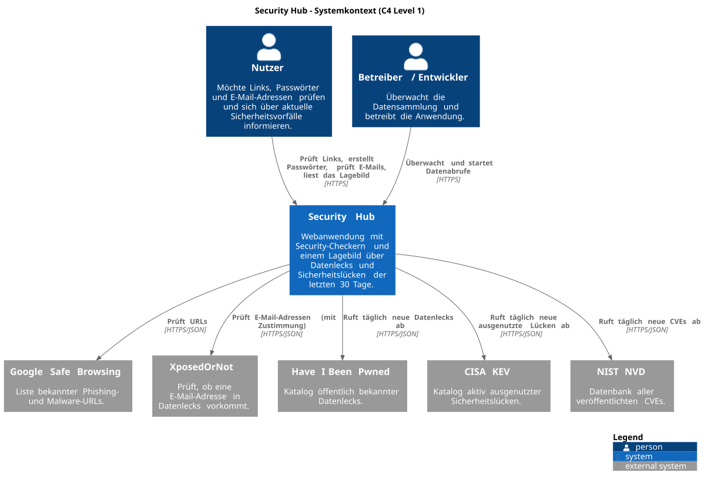
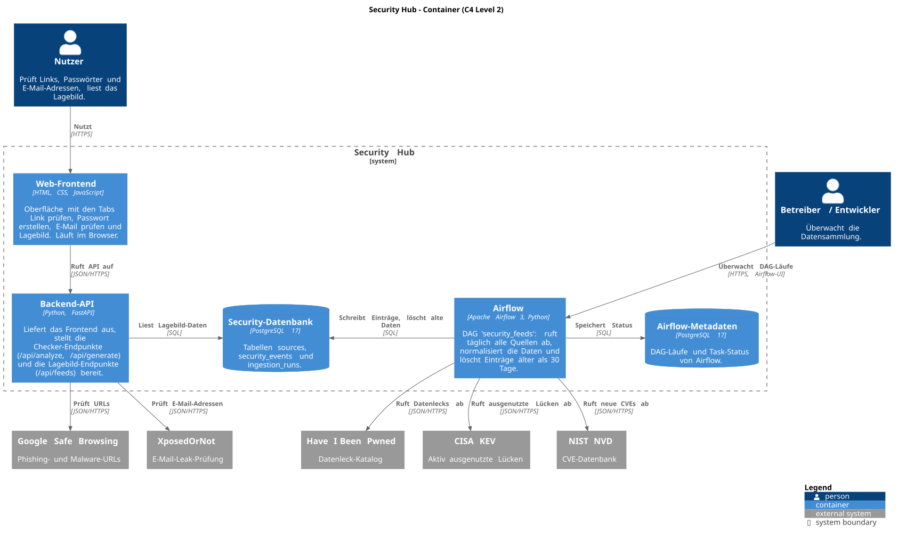

# Architektur – Security Hub

Die Architektur ist nach dem [C4-Modell](https://c4model.com/) dokumentiert.

## Level 1: Systemkontext

Wer nutzt den Security Hub, und mit welchen externen Systemen spricht er?



- **Nutzer** prüfen Links, erstellen Passwörter, prüfen E-Mail-Adressen und lesen das Lagebild.
- **Betreiber / Entwickler** überwachen die tägliche Datensammlung in Airflow.
- **Google Safe Browsing** und **XposedOrNot** werden live bei jeder Prüfung abgefragt.
- **Have I Been Pwned**, **CISA KEV** und **NIST NVD** werden einmal täglich abgerufen. Die Daten der letzten 30 Tage werden gespeichert.

## Level 2: Container

Aus welchen lauffähigen Teilen besteht der Security Hub?



| Container | Technologie | Aufgabe |
|---|---|---|
| Web-Frontend | HTML, CSS, JavaScript | Oberfläche im Browser, wird vom Backend ausgeliefert |
| Backend-API | Python, FastAPI | Checker-Endpunkte (`/api/analyze/*`, `/api/generate/*`) und Lagebild-Endpunkte (`/api/feeds/*`) |
| Airflow | Apache Airflow 3 | DAG `security_feeds`: täglicher Abruf aller Quellen, Speichern, Löschen nach 30 Tagen |
| Security-Datenbank | PostgreSQL 17 | Tabellen `sources`, `security_events`, `ingestion_runs` |
| Airflow-Metadaten | PostgreSQL 17 | Interne Daten von Airflow (eigene Datenbank auf demselben Server) |

### Datenfluss Lagebild

1. Airflow startet täglich den DAG `security_feeds`.
2. Für jede Quelle in `pipeline/sources/` läuft ein eigener Task: Daten abrufen, in ein einheitliches Format (`SecurityEvent`) umwandeln, per Upsert in `security_events` speichern.
3. Der Task `cleanup` löscht Einträge, die älter als 30 Tage sind.
4. Das Backend liest die Daten über `/api/feeds/summary`, das Frontend zeigt sie im Tab „Lagebild“.

## Diagramme bearbeiten

Die Quellen liegen als [C4-PlantUML](https://github.com/plantuml-stdlib/C4-PlantUML) in `docs/c4/*.puml`.
Nach einer Änderung neu rendern (lokal per Docker, ohne externen Dienst):

```bash
docker run --rm -v "$PWD/docs/c4:/data" plantuml/plantuml -tsvg -charset UTF-8 /data/context.puml /data/container.puml
docker run --rm -v "$PWD/docs/c4:/data" plantuml/plantuml -tpng -charset UTF-8 /data/context.puml /data/container.puml
```
